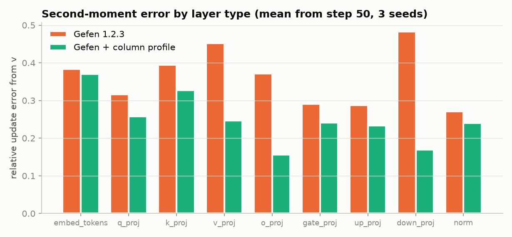
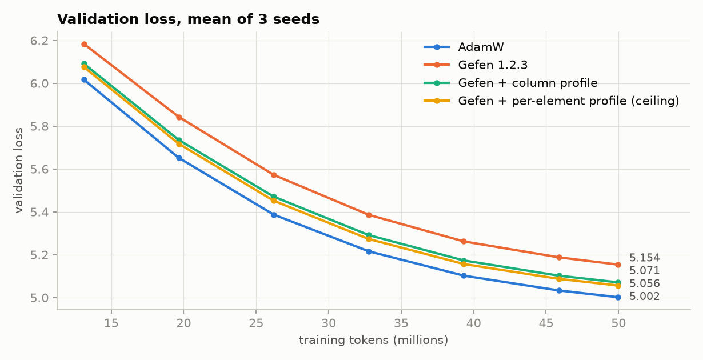
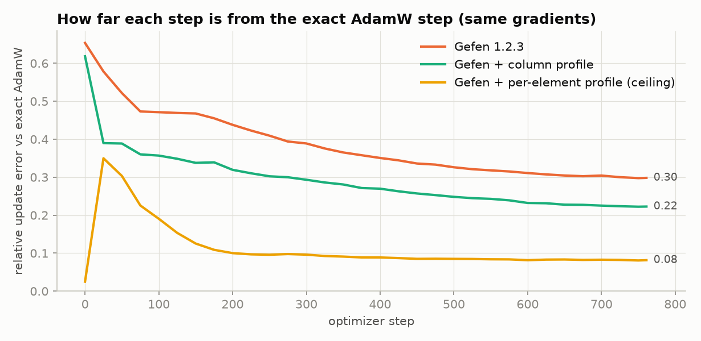
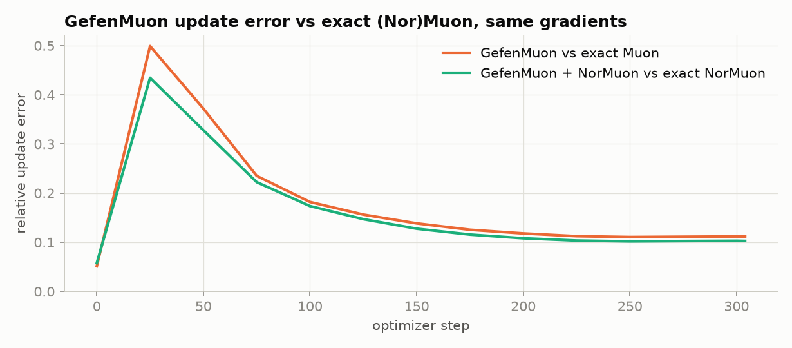
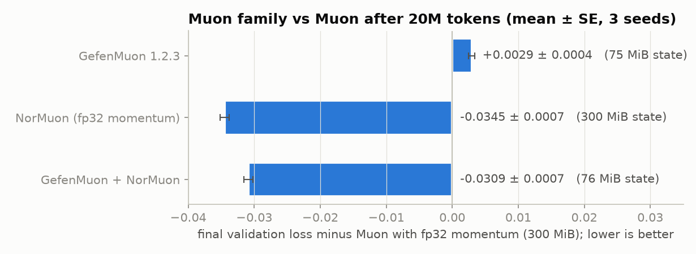

# Gefen accuracy experiments

This fork of [Gefen](https://github.com/ndvbd/Gefen) (original project "Gefen" by Nadav Benedek) studies where
Gefen loses accuracy compared with AdamW and tests small, opt-in fixes. Everything below was measured on a
100M-parameter Qwen3-architecture model. The code changes sit on top of Gefen 1.2.3, and with no variant
enabled the optimizer is bit-for-bit identical to 1.2.3 (checked with `bench/equiv_check.py`).

## Summary

| Optimizer | Gap to its full-precision reference | Optimizer state | Status |
|---|---|---|---|
| Gefen 1.2.3 (vs AdamW, 50M tokens) | +0.152 ± 0.020 val loss | 96 MiB (AdamW: 756 MiB) | baseline |
| **Gefen + column profile** (`GEFEN_FLAGS=vprof_col`) | **+0.069 ± 0.011** | 96 MiB | halves the gap at no memory cost |
| GefenMuon 1.2.3 (vs Muon, 20M tokens) | +0.0029 ± 0.0004 | 75 MiB (Muon: 300 MiB) | baseline |
| **GefenMuon + NorMuon** (`normuon=True`) | **−0.0309 ± 0.0007** vs Muon | 76 MiB | NorMuon's gain carries over intact |

Gaps are final validation loss differences, paired by seed, mean ± standard error over 3 seeds.

## Setup

- **Model:** Qwen3 architecture via `transformers` (hidden 640, 16 layers, 10 query and 5 KV heads, head dim 64,
  MLP 1920, vocab 32000, tied embeddings), 99.15M parameters.
- **Data:** FineWeb-Edu (`sample/10BT`, first shard), a 32k byte-level BPE trained on it, sequence length 1024,
  65,536 tokens per optimizer step. Validation loss is measured on 4M held-out tokens.
- **Recipe:** lr 6e-4, 2% warmup, cosine decay to 10%, betas (0.9, 0.95), weight decay 0.1, gradient clipping 1.0,
  bf16 autocast with fp32 weights. 50M tokens (762 steps) for the Adam runs, 20M tokens (305 steps) for the Muon runs.
- **Hardware:** one NVIDIA CMP 170HX (sm_80), about 95k tokens/s for this model.
- **Decision rule:** keep a change only if it shrinks the paired gap by more than two standard errors and grows
  optimizer state by less than 2%.
- **Update-error probe:** an exact fp32 copy of AdamW (or Muon) runs on the same gradients. Every 25 steps it
  measures how far the step Gefen actually took is from the exact step (relative L2 error), and splits that error
  into a momentum part and a second-moment part.

## 1. Where Gefen 1.2.3 loses accuracy

Gefen stores momentum as 8-bit codebook indices with a per-block scale, and stores the second moment as **one
shared value per block** of parameters (a block is usually one row of a weight matrix, chosen automatically at
step 0). The probe shows the error comes almost entirely from that shared second moment:

- total update error 0.374, momentum part 0.025, second-moment part 0.374 (mean from step 50);
- applying the update from the unquantized momentum (variant 2a, `GEFEN_FLAGS=unquant_update`) changed the loss
  by only 0.006 ± 0.005, so it was dropped.

The second-moment error is largest in `down_proj`, `v_proj` and `k_proj`, where gradient scale varies a lot
along a row.



## 2. Fix: a column profile for the shared second moment

A shared per-row value cannot follow the fact that some input columns get much larger gradients than others.
The `vprof_col` variant adds a per-column factor, so the second moment becomes

```
v[row, col] ≈ vmean[row] × profile[col]
```

a rank-1 factorization in the style of Adafactor, on top of Gefen's per-block value. `profile` is an EMA (with
beta2) of the column mean of g², normalized to mean 1. It costs one float per position in a block, under 0.5 MiB for the
whole model.

It is implemented without touching the CUDA kernels: the gradient is divided by `sqrt(profile)` before it reaches
them, so the momentum and second moment are kept in the profile-scaled space and the update comes out as
`m / sqrt(vmean × profile)`. Throughput was unchanged within 1%.



The column profile cuts the update error from 0.30 to 0.22 by the end of training and halves the gap to AdamW
(0.152 → 0.069). A per-element profile (`vprof_full`, 4 extra bytes per parameter, so it fails the memory rule)
was run as a ceiling: it reaches a 0.055 gap, so the column profile recovers about 85% of what any fix to the
second moment can.



With the second moment nearly exact, the ceiling still trails AdamW by 0.055 and its remaining error is mostly
momentum (0.09). A likely cause is the codebook: it is learned once from raw gradients at step 0, but momentum
now lives in the profile-scaled space. The largest remaining second-moment error with `vprof_col` is in
`embed_tokens` (0.37).

## 3. GefenMuon and NorMuon

GefenMuon keeps Muon's momentum in 8 bits. The probe shows a much larger update error than with Adam (0.15 on
average, peaking near 0.5 early in training), because Newton-Schulz orthogonalization raises weak, noisy
directions of the momentum to full strength. Even so, it costs very little loss: GefenMuon trails Muon by
0.0029 ± 0.0004.



NorMuon (Li et al., 2025) adds a per-output-row second moment to the orthogonalized update.
This fork adds it to GefenMuon as `normuon=True` (one fp32 value per output row, 0.4 MiB for this model; the
update is rescaled to RMS 0.2 like AdamW). It improves GefenMuon by 0.034, the same gain it gives Muon with fp32
momentum.



In these runs the embedding and norms use AdamW and every Muon variant uses the AdamW learning rate with
RMS-matched updates. The GefenMuon runs had the probe on, which repeats Newton-Schulz every step, so their
throughput is not comparable to the references.

## Using the variants

```python
import os
os.environ["GEFEN_FLAGS"] = "vprof_col"   # read when the optimizer is constructed
from gefen import Gefen
opt = Gefen(named_params, lr=6e-4, betas=(0.9, 0.95), weight_decay=0.1)

from gefen import GefenMuon
opt = GefenMuon(named_hidden_matrices, lr=6e-4, adjust_lr_fn="match_rms_adamw", normuon=True)
```

| `GEFEN_FLAGS` entry | What it does | Tested here |
|---|---|---|
| `vprof_col` | column profile × per-block second moment | yes, kept |
| `vprof_full` | per-element profile (+4 bytes/parameter), a ceiling | yes, diagnostic |
| `unquant_update` | apply the update from the unquantized momentum (CUDA path) | yes, no significant gain |
| `sr` | stochastic rounding of momentum onto the codebook (CUDA path) | implemented, not benchmarked |

## Limitations

- One small model, short runs (50M and 20M tokens), one learning rate and 3 seeds per configuration. The gains
  should be confirmed at longer horizons and larger scale before relying on them.
- Only bf16 autocast with fp32 weights and beta2 = 0.95 was tested. Pure bf16 training and beta2 = 0.999 are not
  covered.
- `vprof_col` adds a Python-side elementwise pass and a temporary copy of each gradient; a fused kernel would
  avoid both.
- The Muon comparison has no AdamW reference at 20M tokens, so it does not say whether Muon beats AdamW here.

## Reproducing

The scripts default to `/workspace` paths (`--data`, `--out`, `--gefen_src` change them). Download the first
FineWeb-Edu `sample/10BT` shard (`000_00000.parquet`) to `/workspace/data/fineweb-edu/sample/10BT/`, then:

```bash
pip install -e . && pip install transformers pyarrow tokenizers numba matplotlib
python bench/prep_data.py                  # tokenizer + train/val bins under /workspace/data
bash bench/queue.sh bench/jobs_iter1.txt   # AdamW, Gefen 1.2.3, variant 2a
bash bench/queue.sh bench/jobs_iter2.txt   # vprof_col, vprof_full
bash bench/queue.sh bench/jobs_iter3.txt   # Muon, GefenMuon, NorMuon variants
python bench/plot_results.py               # rebuilds figures/accuracy from bench/run_logs
```

The raw logs of every run in this document are in `bench/run_logs`, and the per-iteration tables are in
`bench/results_iter*.md`. See `bench/README.md` for the scripts.

## Credit and citation

Gefen is by Nadav Benedek, Tomer Koren and Ohad Fried; this fork only adds experiments on top of it. If you use
it, cite the original work:

```bibtex
@article{benedek2026gefen,
  title={Gefen: Optimized Stochastic Optimizer},
  author={Benedek, Nadav and Koren, Tomer and Fried, Ohad},
  journal={arXiv preprint arXiv:2606.13894},
  year={2026}
}
```
